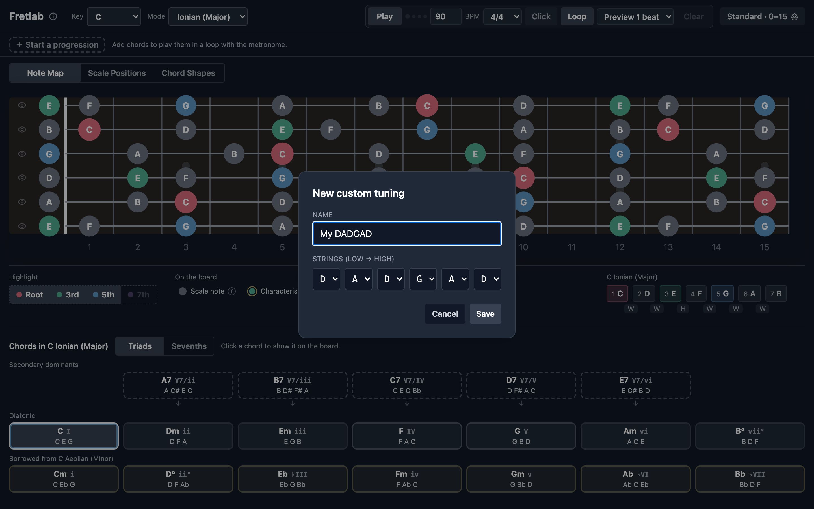
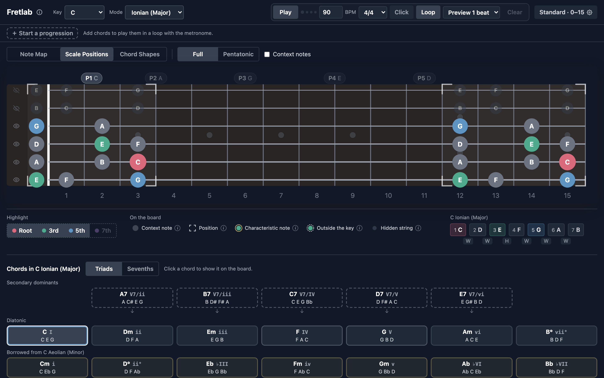

# Fretlab

[](https://github.com/felix-zailskas/fretlab/actions/workflows/ci.yml?query=branch%3Amain)
[](https://github.com/felix-zailskas/fretlab/actions/workflows/deploy.yml)
[](LICENSE)
[](https://ko-fi.com/felixzailskas)

**[Try it live →](https://fretlab.studio/)**

A key-aware fretboard reference for guitarists. Sits next to you during practice —
laptop or iPad on a music stand — and answers questions like _"which notes do I target
soloing over ii in G in position 3?"_ fast enough not to interrupt your flow.

Fretlab is a **reference tool, not a tutorial.** It is aimed at intermediate and
advanced players who already know what they want to practice and need a clean visual
lookup.


## About

Fretlab visualizes music theory directly on the guitar neck. Pick a key, pick a chord,
pick one or more CAGED positions, and the relevant notes light up in interval colors
(root / 3rd / 5th / 7th) against a faint scale background. A header-level mode selector
extends practice to the seven parallel modes — switching to Dorian, Lydian, Phrygian,
etc. re-anchors every view to the modal scale.

The whole interface is designed for **fast switching during practice**: instant key,
mode, chord, and position changes, and consistent coloring across all views (R / 3rd /
5th / 7th have fixed colors, and out-of-key notes are hidden by default). The only
motion is a short fade when the chord changes, so you can see which notes move and which
stay put.

### The page at a glance

The whole page is built to fit a 1280×720 screen above the fold:

- **Header** — Key and Mode, the transport (Play, BPM, time signature, Click, Loop,
  next-chord preview, Clear), and a **Settings** button summarising tuning and fret
  range (`Standard · 0–15 ⚙`). Settings holds ♭ / ♯ spelling, theme, tuning and frets.
- **Progression lane** — a slim strip under the header where a chord progression is
  built and played (see [Progression player](#progression-player)).
- **View tabs** — Note Map, Scale Positions, Chord Shapes, with each view's own options
  right next to them (Full / Pentatonic, Inversions / CAGED, string groups, …).
- **Fretboard** — with clickable position or shape labels above it where the view has
  them, and an eye per string on its left.
- **Legend** — the Highlight toggles (R / 3rd / 5th / 7th), the symbols the current view
  can show (each with an ⓘ tooltip explaining it), and the scale with its degrees.
- **Chord map** — every chord of the key, at the bottom.

A **theme** setting cycles Auto / Light / Dark — Auto follows the system
`prefers-color-scheme`, and its label shows which theme Auto currently resolves to.

## Views

Each tab in Fretlab answers a different practice question. Three views ship today, plus
the cross-cutting [Modal practice mode](#modal-practice-mode) that augments all of them
(see the [vision document](docs/design/2026-05-05-app-vision-and-view-designs.md) for
the full roadmap and what's deferred).

### Note Map


The default landing view. For the selected key, all in-key notes render across the
visible fret range (default 0–15, configurable in Settings up to fret 24). Root / 3rd /
5th / 7th appear in their interval colors; the rest of the scale (2nd / 4th / 6th) is
muted.

The **chord map** below the board lists the key's chords as compact cards, each with its
Roman numeral and notes:

- the 7 **diatonic** chords;
- the **secondary dominants** (V7/ii, V7/V, …), each placed above the chord it resolves
  to with a small arrow;
- the **borrowed** chords from the parallel mode (Aeolian for major-third modes, Ionian
  for minor-third modes), on a tinted background.

Selecting a card remaps the highlights so that chord's R / 3 / 5 / 7 light up against
the muted scale background. Chord tones outside the key (the C♯ of A7 in C major) get a
dashed ring and are spelled the chord's way, and the key note they replace (C) is
hidden. Clicking the selected card again clears the highlights. A Triads / Sevenths
switch next to the chord map's title applies to every row.

**Features**

- 12-key selector plus an "All notes" option that disables key filtering
- **Diatonic note spelling** — every scale uses all 7 letter names with the right
  accidentals, so C♯ Ionian reads as `C♯ D♯ E♯ F♯ G♯ A♯ B♯` (not the enharmonic mishmash
  `C♯ D♯ F F♯ G♯ A♯ C`). Double accidentals appear for theoretical roots like A♯ major.
- Sharp / flat spelling (in Settings) for the chromatic "All notes" view (in-scale notes
  are always spelled diatonically — the toggle has no effect on them)
- Configurable fret range (default 0–15, ceiling 24); the chosen range applies to every
  view
- Chord map with diatonic, secondary-dominant and borrowed chords, and a triads /
  sevenths switch (R/3/5 or R/3/5/7 highlighting)
- Highlight toggles for R / 3rd / 5th / 7th to show or hide chord-tone roles. When a
  role isn't available (the 7th of a triad), hovering or focusing it says why.

**During practice**

- Get familiar with where notes sit in a given key across the entire fretboard.
- Quickly check where a chord's R / 3 / 5 / 7 live when you're improvising or arranging.

### Scale Positions


A consolidated CAGED-box practice tool. The five positions are switched on and off from
labels above the board (`P1 C`, `P2 A`, …), each sitting over the box it controls. A
position that doesn't fit the current fret range keeps its label, pinned to the right
edge, so it stays reachable. Each selected position renders as a bracketed region on the
neck. When two or more boxes overlap, the shared frets render as a brighter outlined
zone — reinforcing that the CAGED shapes are connected pieces of one continuous map, not
isolated islands.

The view supports two complementary practice modes via the same controls:

- **Chord-tone targeting** — pick a chord from the chord map. The chord's R / 3 / 5 / 7
  light up _inside_ the selected positions, against the scale-tone background.
- **Pure scale-position study** — click the selected chord card again to deselect it.
  With no chord active, every in-key note renders as a plain scale tone, leaving just
  the box framing on the neck.

**Full / Pentatonic** sits next to the view tabs. Pentatonic reduces each box to the
major pentatonic (Ionian without 4 and 7) or minor pentatonic (Aeolian without 2 and 6).
A chord tone the pentatonic leaves out still shows, as a hollow note, so you can see
what the chord adds. In the other modes the switch is disabled (there's no conventional
pentatonic) and explains why.

**Features**

- Independent toggles for the 5 CAGED positions (P1 C-shape through P5 D-shape, the
  canonical CAGED order ascending from open in C major); any combination is valid
- Multi-octave window placement: every octave that fits fully inside the visible fret
  range renders as its own bracketed box
- Corner-bracket framing on each selected position, with brighter overlap zones
- Full / Pentatonic switch for Ionian and Aeolian, with hollow non-pentatonic chord
  tones
- "Context notes": in-key notes outside the selected positions in a faint color, useful
  when practicing transitions

**During practice**

- _Box study_ — _"What does the C-shape (P1) look like in G major? Where does it overlap
  with the A-shape (P2)?"_ Toggle on adjacent positions and the overlap zone shows you
  exactly which frets connect them.
- _Target-tone soloing_ — _"Soloing over Am7 in P3 — where do I aim?"_ Pick the chord,
  pick the position, and the chord's R / 3 / 5 / 7 light up only inside the box.
- _Pentatonic soloing_ — switch to Pentatonic and keep the chord selected: the hollow
  notes are the chord tones the pentatonic box doesn't cover.

### Chord Shapes


A chord-centric view: pick a chord from the chord map and Fretlab renders every fitting
placement of it across the visible fret range. An **Inversions | CAGED** switch next to
the view tabs picks how the chord is voiced.

**Inversions** follows the chord map's Triads / Sevenths switch:

- **Triad shapes** — major / minor / diminished triad inversions across four 3-string
  groups and three inversions (Root / 1st / 2nd). The string groups are small fretboard
  icons; hover or focus one for its name (`Strings 1-2-3 (high E side)`).
- **7th chord shapes** — full 4-note voicings (R / 3 / 5 / 7) generated from a unified
  close-voicing → drop pipeline. A **Voicing system** select (Close / Drop 2 / Drop 3 /
  Drop 2&4) picks the system, and each system exposes its own string sets (drop-2 uses
  adjacent 4-string sets, drop-3 skips a string, e.g.
  `Strings 6-4-3-2 (skips string 5)`). All four inversions (Root / 1st / 2nd / 3rd) are
  available.

String-group and inversion selections are **shared across voicing systems** via a low /
mid / high position abstraction — switching from drop-2 to drop-3 with the "low"
position selected keeps your hand in the same neck region.


**CAGED** shows the chord as its full barre and open shapes — the C, A, G, E and D
shapes — toggled from labels above the board (E and A are on by default). A barre is
drawn as a bar across the strings, and strings the shape doesn't play are marked ×. This
answers questions like _"where's the F barre chord?"_: in F major the E-shape sits at
fret 1 with its barre. A secondary dominant keeps its 7th in CAGED, since its resolution
hinges on it.

**Features**

- Inversions: triads on four string groups, sevenths in four voicing systems — 160
  seventh-chord voicings across 4 systems × valid string sets × 4 inversions × 4
  qualities
- CAGED: five full-chord shapes with barre and unplayed-string marks, derived from the
  same CAGED positions as Scale Positions
- Multiple string groups / inversions / shapes can be on at once and stack on the board
- **Dim, don't hide:** unselected Highlight roles render as muted gray on this view
  instead of disappearing, so the chord shape stays recognizable

**During practice**

- _Voicing comparison_ — _"What does Cmaj7 look like as a drop-2 vs. drop-3?"_ Same
  chord, swap the voicing system, see both shapes as you cycle.
- _Inversion drilling_ — _"Where do I find Cmaj7 with the 3 in the bass?"_ Toggle 1st
  inversion only and the view shows every placement that fits the fret range.
- _Barre chords for beginners_ — switch to CAGED and toggle the shapes one at a time to
  see how the same chord moves up the neck.

## Modal practice mode


A header-level **Mode** select sits next to Key and turns Fretlab into a parallel-modes
practice tool. The seven modes of the major scale — Ionian, Dorian, Phrygian, Lydian,
Mixolydian, Aeolian, Locrian — are one pick away. Whenever a non-Ionian mode is active,
the entire app re-anchors:

- **Chord map** recomputes against the modal scale (e.g. C Dorian shows
  `i7, ii7, ♭IIImaj7, IV7, v7, viø7, ♭VIImaj7`).
- **The scale in the legend** relabels degrees with modal accidentals (`♭3`, `♯4`, etc.)
  so the difference from same-root major is immediately visible.
- **Scale Positions** reanchors its CAGED windows to the mode's _parent major scale_
  (e.g. C Dorian uses B♭ major's CAGED positions). Position labels drop the C/A/G/E/D
  shape letter in non-Ionian modes since those names refer to major-scale fingerings.
- **Characteristic-tone overlay** — a subtle gold ring on the fretboard around each
  mode's defining tone: Dorian's ♮6, Lydian's ♯4, Phrygian's ♭2, Mixolydian's ♭7,
  Locrian's ♭5. Ionian and Aeolian (the references) have no characteristic-tone ring.
- **Spelling auto-adjusts** to the parent major's natural preference. Picking D Lydian
  flips the accidental toggle to sharps (parent A major); picking D Phrygian flips it to
  flats (parent B♭ major). Manual override is still available in Settings — the override
  sticks until the next key/mode change.

For Ionian (the default), behavior is byte-identical to a non-modal Fretlab — modal mode
adds capability without disturbing major-scale practice.

**Features**

- 7-mode select in the app header alongside Key
- Cross-cutting effect: Note Map, Scale Positions, and Chord Shapes all respect the
  active mode
- Modal Roman numerals in the chord map (`♭IIImaj7`, `viø7`, `♯ivø7`, etc.)
- Modal degree labels (`1, 2, ♭3, 4, 5, 6, ♭7` for Dorian, etc.) with whole/half-step
  pattern reshuffled per mode
- Parent-major-anchored CAGED windows in Scale Positions for non-Ionian modes
- Characteristic-tone gold ring on the fretboard
- Accidental auto-set: spelling follows the parent major scale; user override sticks
  until next key/mode change

**During practice**

- _Modal jam_ — vamp on Dm7 in D Dorian; the modal chord map + characteristic ♮6 are
  visible without leaving the view.
- _Mode comparison_ — flip between C Lydian and C Mixolydian; the ♯4 ↔ ♭7 swap is
  visible on the fretboard ring overlay and in the legend's degree labels.
- _Working with modal harmony_ — `♭IIImaj7` in Dorian or `♯ivø7` in Lydian read directly
  off the chord map, no mental transposition.

## Tunings


The **Tuning** selector in Settings switches between 18 preset tunings plus any custom
tunings you've saved. Presets are grouped by category in the popover:

- **Standard** — Standard, Eb Standard, D Standard, C# Standard.
- **Open** — Open G, Open D, Open E, Open A, Open C, Open Dm, Open Gm.
- **Drop** — Drop D, Double Drop D, Drop C, Drop B.
- **Modal & Other** — DADGAD, All Fourths, New Standard (NST).
- **Custom** — your saved custom tunings (only visible once you've created one).

The active tuning is shown on the Settings button (`Standard · 0–15`) and on the
selector itself. Each option in the popover lists the tuning's open strings (low → high)
as a memory aid.

### Custom tunings



Pick `+ New custom tuning…` at the bottom of the tuning popover to define your own
6-string tuning: a name plus a chromatic-note pick for each string (low → high). Custom
tunings are saved to `localStorage` and survive reloads, including the
currently-selected one. The `✎` button next to the tuning selector opens the same modal
in edit mode for the active custom tuning, with **Save**, **Save as copy** (forks the
current values into a new entry), and **Delete** (two-stage inline confirm) actions.

Custom tunings participate in view gating identically to presets — if the intervals
between adjacent strings match standard's `[5, 5, 5, 4, 5]` semitone pattern, all three
views unlock; otherwise the tuning is restricted to Note Map. Anything goes for the note
choices themselves: duplicates, non-monotonic orderings, and theoretical roots are all
allowed.

### View support across tunings

CAGED, drop-2, and drop-3 voicings — the pedagogy underlying Scale Positions and Chord
Shapes — depend on standard tuning's specific interval pattern between adjacent strings
(`[5, 5, 5, 4, 5]` semitones). Tunings that **preserve** that pattern unlock all three
views; tunings that **break** it are restricted to Note Map.

| Tuning category                 | Note Map |   Scale Positions   |    Chord Shapes     |
| ------------------------------- | :------: | :-----------------: | :-----------------: |
| Standard, Eb / D / C# Standard  |    ✓     |          ✓          |          ✓          |
| All Open / Drop / Modal tunings |    ✓     |                     |                     |
| Custom tunings                  |    ✓     | if CAGED-compatible | if CAGED-compatible |

The rule is **derived from the strings**, not hand-flagged — `isCagedCompatible()` in
[`src/theory/tuning.ts`](src/theory/tuning.ts) checks the interval pattern at module
load. Adding a future preset (or saving a new custom tuning) auto-resolves which views
it supports.

When you select a tuning that doesn't support the active view, the view body shows an
empty state explaining why and offers a one-click **Switch to Standard tuning** button.
Switching back re-renders the view normally; your previous tab selection is preserved.

In CAGED-compatible step-down tunings (Eb / D / C# Standard), the entire CAGED-window
math shifts by the tuning's offset — so C major P1 sits at frets 1-4 in Eb Standard, 2-5
in D Standard, and 3-6 in C# Standard. The labeled shape (P1 — C, P2 — A, etc.)
correctly identifies where each shape's barre actually lives on the new neck.

**Features**

- 18 preset tunings across four categories, grouped in the selector popover
- Step-down standards (Eb / D / C# Standard) with all three views available; box and
  chord-shape positions auto-shift to track the tuning
- Non-CAGED tunings gated to Note Map with a clear empty state on the other tabs (with a
  "Stay on Note Map" shortcut so you stay productive in the one view that does work)
- Custom tunings with `localStorage` persistence — save, edit, fork (Save as copy),
  delete, and the last-selected tuning is restored on reload

**During practice**

- _Slide-blues study_ — pick Open G or Open D, see the in-key notes laid out for
  bottleneck practice without doing the mental retuning.
- _Tuned-down rock / metal_ — Eb / D Standard with key labels honest to the actual
  fretboard; CAGED shapes still work because intervals are preserved.
- _DADGAD fingerstyle_ — Note Map in DADGAD (key D) shows where the in-key notes fall on
  the modally-tuned neck; chord-shape pedagogy isn't applicable so the gating message
  keeps you honest.

## String focus



An eye-icon column on the left of every fretboard lets you mute individual strings.
Click an eye to toggle that string — the icon swaps to an eye-with-slash, and every
marker on that string demotes to the muted color (dim gray) on Note Map, Scale
Positions, and Chord Shapes. Muting a string never reveals notes that weren't already
visible: it only changes how the existing markers render, so the box framing and
chord-shape geometry stay intact and the muted strings act as a visual "ignore this for
now" cue.

String state is global across views (mute the high E in Scale Positions and it stays
muted when you switch to Chord Shapes) and ephemeral within a session — the default is
all six strings enabled on every reload.

**During practice**

- _Three-string set focus_ — drilling chord shapes on strings 1-3? Mute the bottom three
  so your eye doesn't wander.
- _Bass-string isolation_ — practicing walking bass lines on strings 5-6? Mute the top
  four to keep the page visually quiet.
- _Single-string scale runs_ — mute everything except one string for horizontal-scale
  practice up the neck.

## Progression player


Build a chord progression and play it back in time, in the slim lane under the header.

- **Build** — `＋ Start a progression` (or `＋ Add chord` once there are chords) opens
  the chord map as a picker: diatonic, secondary dominants and borrowed chords, laid out
  exactly like the chord map below the board. Click chords to append them; the picker
  stays open so you can add several in a row (Esc or a click outside closes it). Drag a
  chord by its ⠿ handle to reorder it, set its length with − / + (½ bar is offered when
  the bar splits evenly), and remove it with ×.
- **Play** — the fretboard follows the current chord in every view, and the chord map
  rings it. A line fills each chord's chip as it plays, with a tick on every beat and a
  taller one on each bar's 1, so you can tell where you are in a long chord. The next
  chord's chip is outlined.
- **See it coming** — when the chord changes, notes the two chords share stay in place
  and only change color; the others fade out and in. Before the change, thin rings in
  the new colors mark where the next chord's highlighted notes land, fading from faint
  to full as the change approaches. A note that keeps its role gets no ring. To practise
  landing on one role — say the root of every chord — turn the others off in Highlight
  and only that role's targets are ringed. The transport's preview select sets how early
  the rings appear: 1, 2, 3, 4, 6 or 8 beats before the change (1 by default), or **No
  preview**.

The transport has a BPM field (30–300, counting the time signature's unit, so 6/8 at 120
is 120 eighth notes per minute), time-signature presets (2/4 to 12/8), an optional
accented metronome **Click**, and **Loop**. Progressions are stored by scale degree, so
they transpose with the key and adapt to the mode; a chord that doesn't exist in the
current mode is greyed out and skipped. The progression and its settings are saved in
your browser.

Play also works as a plain metronome: with an empty progression (or with the key set to
All notes, or when no chord is playable) it loops one bar, the click always sounds, and
beat dots next to Play show the count.

## Keyboard shortcuts

A few shortcuts speed up the most common practice flows. They're disabled while focus is
in a text input, and modifier keys (⌘ / Ctrl / Alt) are ignored so they don't interfere
with browser shortcuts.

| Key     | Action                                                                        |
| ------- | ----------------------------------------------------------------------------- |
| `1`–`7` | Select diatonic chord I through vii° (press the active chord to clear)        |
| `t`     | Switch the chord map to **Triads**                                            |
| `s`     | Switch the chord map to **Sevenths**                                          |
| `Space` | Play / stop the progression (ignored while a button or form field is focused) |

## Getting started

Fretlab is a Vite + React + TypeScript app. To run it locally:

```bash
git clone https://github.com/felix-zailskas/fretlab.git
cd fretlab
npm install
npm run dev
```

The dev server prints a local URL (typically `http://localhost:5173/`).

### Available scripts

| Script                | Description                                                   |
| --------------------- | ------------------------------------------------------------- |
| `npm run dev`         | Start the Vite dev server with HMR                            |
| `npm run build`       | Type-check and produce a production build in `dist/`          |
| `npm run preview`     | Preview the production build locally                          |
| `npm run lint`        | Run ESLint                                                    |
| `npm test`            | Run the Vitest suite once (theory unit + RTL component)       |
| `npm run test:watch`  | Run Vitest in watch mode                                      |
| `npm run test:e2e`    | Run Playwright E2E tests (boots the dev server automatically) |
| `npm run test:e2e:ui` | Run Playwright in interactive UI mode for debugging           |

The README's screenshots and GIFs are recorded with
`node scripts/record-assets.mjs [asset …]` against a running dev server (`FRETLAB_URL`
overrides the default `http://localhost:5173/`; GIFs need `ffmpeg` on `PATH`).

### Tech stack

- **React 19** + **TypeScript ~6.0**
- **Vite 8** for the dev server and build
- **Tailwind v4** with semantic color tokens defined via `@theme`
- **Vitest 3** for theory-layer / pure-function tests + **React Testing Library +
  jsdom** for component tests (single `npm test`, environment per file)
- **Playwright** for browser-level E2E tests (separate CI job; not in pre-commit)

## Documentation

- [`docs/design/`](docs/design) — vision and per-view design notes
- [`docs/practice/`](docs/practice) — the practice plan that motivates this tool

## Theory references

The 4-system 7th-chord voicing taxonomy in Chord Shapes (close, drop-2, drop-3,
drop-2&4) was cross-checked against these sources during design:

- [jazzguitar.be — Drop 2 Chords](https://www.jazzguitar.be/blog/drop-2-chords/) —
  drop-2 inversions and string-set conventions on adjacent 4-string sets.
- [learnjazzstandards.com — Drop 2 Voicings](https://www.learnjazzstandards.com/blog/drop-2-voicings/)
  — the close-voicing → drop-2 derivation, with the four bass-position labels.
- [fundamental-changes.com — Jazz Guitar Voicings](https://www.fundamental-changes.com/jazz-guitar-voicings/)
  — overview of close, drop-2, drop-3, and drop-2&4 with worked Cmaj7 examples.
- [guitarwiz.app — Drop 3 Voicings on Guitar](https://guitarwiz.app/articles/drop-3-voicings-guitar/)
  — the skipped-middle-string convention for drop-3 (`6-4-3-2`, `5-3-2-1`).
- [jazz-guitar-licks.com — Drop 2&4 Voicings](https://www.jazz-guitar-licks.com/blog/what-are-drop-2-4-chords-advanced-guitar-voicings.html)
  — drop-2&4 stacking and string-skip layout.

The shape table itself isn't copied from any source; it's generated by a single
algorithm in [`src/theory/chordShapes.ts`](src/theory/chordShapes.ts) (close-voicing
pitches → drop indices → sort → normalize) and spot-checked against known voicings from
the references above.

## Music-theory references

The modal-practice-mode design draws on these sources:

- [Mode (music) — Wikipedia](<https://en.wikipedia.org/wiki/Mode_(music)>)
- [Music Modes: Major and Minor — Berklee Online](https://online.berklee.edu/takenote/music-modes-major-and-minor/)
- [The Seven Modes — The Nandi Method](https://thenandimethod.com/lesson/the-seven-modes/)
- [Modal Schemas — Open Music Theory](https://viva.pressbooks.pub/openmusictheory/chapter/modal-schemas/)
- [Roman Numerals of Diatonic Seventh Chords — University of Puget Sound](https://musictheory.pugetsound.edu/mt21c/RomanNumeralsOfDiatonicSeventhChords.html)

## License

Released under the [MIT License](LICENSE). Copyright © 2026 Felix Zailskas.

Fretlab is free and MIT-licensed. If it saves you time,
[a coffee](https://ko-fi.com/felixzailskas) is appreciated but never expected.
